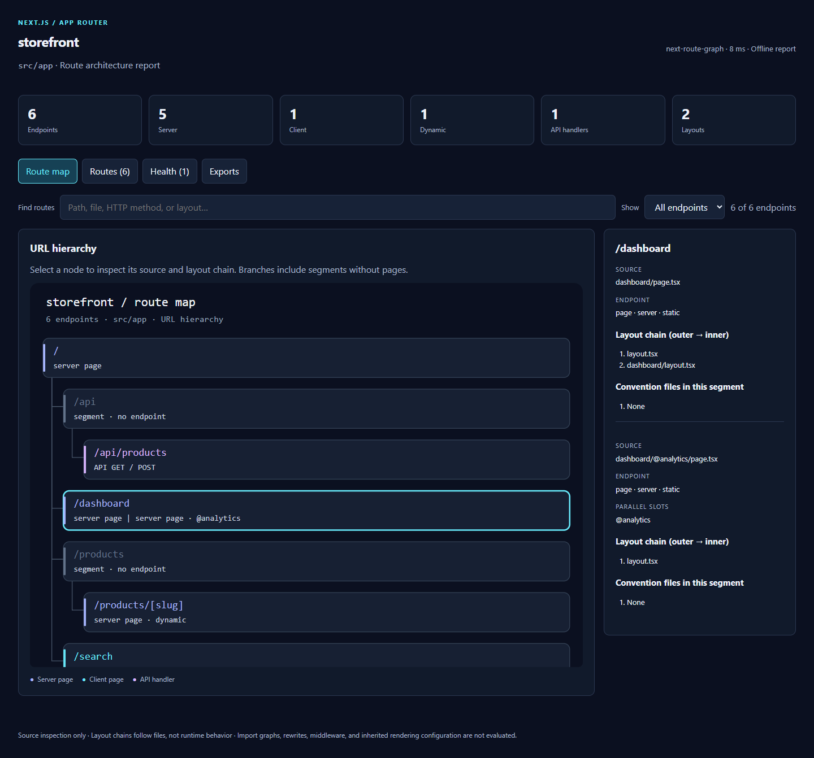

# next-route-graph

[](https://www.npmjs.com/package/next-route-graph)
[](https://github.com/Nima-sltn/next-route-graph/actions/workflows/ci.yml)
[](LICENSE)

Inspect, lint, and visualize a Next.js App Router project without starting Next.js or executing its code. Use the terminal for quick inspection, an offline HTML report for exploration, and SVG for a diagram you can share anywhere.

```sh
npx next-route-graph ./my-app
npx next-route-graph ./my-app --html reports/routes.html
npx next-route-graph ./my-app --svg --output reports/routes.svg
```

Version **1.2.0** adds rendered SVG exports, an offline HTML explorer, and shared CLI/SDK scanning. See the [changelog](CHANGELOG.md) for details.



## What it tells you

- Public URL paths, dynamic segments, route groups, parallel slots, and intercepted targets.
- Page and API handler source files, declared HTTP methods, client directives, Server Actions, and literal segment configuration.
- Layout chains from the outermost layout to each endpoint.
- Route collisions, missing page layouts, page/handler conflicts, slot fallback warnings, and misplaced global error files.

Private folders and build/dependency directories are excluded. Routes are sorted for consistent output. All exports work without a Next.js server.

## Install

Requires Node.js 18 or newer. Run with `npx`, or install in your project:

```sh
npm install -D next-route-graph
```

## Explore visually

```sh
# Standalone report; opens directly from disk and works offline
npx next-route-graph ./my-app --html reports/routes.html

# Local static snapshot; visit the printed URL (default port 3000)
npx next-route-graph ./my-app --serve

# Choose a port, or 0 to choose an available port
npx next-route-graph ./my-app --serve 4300
```

The report has four sections:

| Section | Purpose |
| --- | --- |
| Route map | Rendered SVG hierarchy, including segments without endpoints. Select a node with a mouse or keyboard to inspect every source and its layout chain. |
| Routes | Search paths, source files, methods, or layouts; filter pages, handlers, rendering declarations, dynamic routes, slots, or interceptions. Download matching rows as CSV. |
| Health | Project-wide diagnostics with rule names, locations, and actionable hints. |
| Exports | Download SVG, Mermaid, DOT, Markdown, JSON, flat paths, or a plain terminal tree. One selector keeps the interface compact. |

Multiple sources at one URL remain inspectable. Map filtering dims unrelated branches and retains ancestors for context. Report downloads contain all endpoints included in the report; CSV uses the current browser filter.

SVG is a real vector image. Mermaid and Graphviz DOT are source formats for their respective renderers; they do not need to render in your terminal. The HTML map renders directly without a CDN or a graph library. The preview server binds only to `127.0.0.1` and serves the in-memory report. Rerun the command to refresh its snapshot.

## Export and automate

Choose one format flag, or use `--format`. `--output` works for every format and creates missing parent directories. File-write notices go to stderr; stdout remains suitable for pipes.

| Format | Flag | Use |
| --- | --- | --- |
| Terminal tree | Default / `--format tree` | Quick overview and lint summary |
| Flat paths | `--flat` | Shell pipelines |
| JSON | `--json` | SDK consumers, build tools, or AI context |
| SVG | `--svg` | Rendered image for reports and design tools |
| HTML | `--html [file]` / `--format html` | Offline interactive report |
| Mermaid | `--mermaid` | Fenced diagram for Markdown documentation |
| Graphviz DOT | `--dot` | Graphviz processing |
| Markdown | `--markdown` | Documentation table |

```sh
npx next-route-graph ./my-app --json --output reports/routes.json
npx next-route-graph ./my-app --mermaid --output reports/routes.md
npx next-route-graph ./my-app --dot --output reports/routes.dot
dot -Tsvg reports/routes.dot -o reports/graphviz.svg

# Stream HTML instead of writing a report file
npx next-route-graph ./my-app --format html > routes.html

# Case-insensitive filtering by path, file, or HTTP method
npx next-route-graph ./my-app --search POST --json
```

`--search` changes endpoint counts in the report; layout/loading/error-file totals and diagnostics still describe the whole project. A filtered export cannot hide a CI failure. Use `--output -` to explicitly write to stdout. `--html` defaults to `route-graph.html`.

## Validate in CI

```sh
npx next-route-graph check ./my-app
npx next-route-graph check ./my-app --strict --json

# Save a reviewable artifact even if validation fails
npx next-route-graph ./my-app --strict --format html --output reports/routes.html
```

| Command | Exit 1 when |
| --- | --- |
| Default scan | Scanning or output fails |
| `check` / `--check` | Scanning fails or lint errors exist |
| `--strict` | Scanning fails or lint errors or warnings exist |

JSON scan errors are written as `{ "error": "…", "code": "…" }` to stderr. Successful report data is written to stdout or the requested file. Invalid options also fail. A strict file export is written before lint determines the exit code.

Example GitHub Actions step after installing your project's dependencies:

```yaml
- name: Check routing and generate a report
  run: npx next-route-graph . --strict --format html --output reports/routes.html
- name: Save report
  if: always()
  uses: actions/upload-artifact@v4
  with:
    name: route-report
    path: reports/routes.html
```

## TypeScript SDK

```ts
import { inspectProject, filterRoutes, getRenderer } from "next-route-graph";
import { writeFile } from "node:fs/promises";

const result = await inspectProject("./my-app");
await writeFile("routes.html", getRenderer("html").render(result));
await writeFile("routes.svg", getRenderer("svg").render(result));

const api = filterRoutes(result, "api/"); // returns a new result
console.log(api.summary.apiRoutes);
if (result.lint?.hasErrors) process.exitCode = 1;
```

The lower-level `detectAppRouter()`, `scanAppDir()`, `analyzeRoutes()`, and `lintRoutes()` APIs remain available. `buildRouteGraph(result.routes)` exposes URL nodes with stable IDs within an export, parent IDs, depth, and all endpoint sources attached to each node. `getRenderer()` rejects unknown formats. See [architecture](docs/ARCHITECTURE.md) for module boundaries.

## Scope and limitations

This is static **App Router** source inspection, not a replacement for `next build`. Pages Router, metadata-generated endpoints, custom `pageExtensions`, rewrites, redirects, middleware/proxy behavior, and imports are not evaluated. Source extraction uses comment-aware text parsing, not an AST or TypeScript evaluation; computed exports, complex string contents, and re-export chains can be incomplete. Detected HTTP methods are declared methods, not Next.js-generated methods.

“Server” means the file has no top-level `use client` directive. It does not prove static generation, caching, SSR behavior, or imported component boundaries. Runtime and dynamic configuration show local literal declarations, not inherited effective values. The URL graph describes structure; its edges do not imply imports, navigation links, or layout inheritance. Layout inheritance appears separately in the details panel.

Diagnostics intentionally cover a small set of routing conventions. Parallel fallback warnings flag potentially unmatched navigation; the tool does not simulate navigation. Share exported reports with the same care as source filenames and internal endpoint names: they contain those names and detected metadata, but never source file contents.

Framework references: [intercepting routes](https://nextjs.org/docs/app/api-reference/file-conventions/intercepting-routes), [parallel routes](https://nextjs.org/docs/app/api-reference/file-conventions/parallel-routes), and [layouts](https://nextjs.org/docs/app/api-reference/file-conventions/layout).

## Development

```sh
npm ci
npm run typecheck
npm test                 # builds first; unit, CLI, SDK, and HTTP integration tests
npx playwright install chromium
npm run test:browser     # builds first; real offline browser workflow
```

Browser development tests require Node.js 20 or newer. To use installed Chrome in PowerShell: `$env:PLAYWRIGHT_CHROMIUM_CHANNEL='chrome'`. Set `NRG_REPORT_ARTIFACT_DIR=reports` to save the example HTML and desktop/mobile screenshots during browser tests.

- [Contributing](CONTRIBUTING.md)
- [Architecture and trade-offs](docs/ARCHITECTURE.md)
- [Architecture decision](docs/adr/0001-offline-reports-and-shared-route-graph.md)
- [Improvement evidence](docs/NEW_FEATURES.md)
- [Changelog](CHANGELOG.md)
- [Security](SECURITY.md)

[MIT](LICENSE) © 2026 Nima Soltanian
