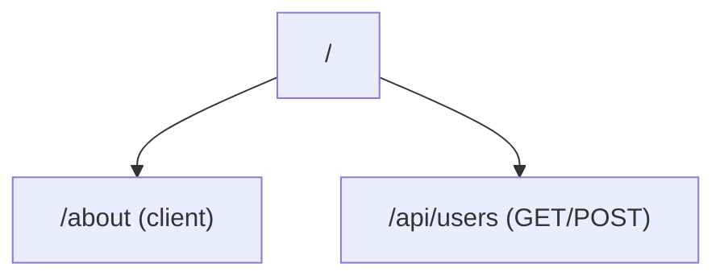

# next-route-graph

[](https://www.npmjs.com/package/next-route-graph)
[](https://opensource.org/licenses/MIT)
[](https://nodejs.org)
[](https://www.typescriptlang.org)
[](https://github.com/Nima-sltn/next-route-graph)

> Inspect, lint, and visualize the structure of your Next.js App Router project from the terminal or programmatic TypeScript SDK.

`next-route-graph` is a lightweight, zero-config CLI and SDK that scans your `app/` or `src/app/` directory and turns your routing architecture into a clear visual overview.

Useful for auditing large codebases, preventing route collisions in CI/CD, onboarding developers, generating README diagrams, or supplying structured context to AI coding assistants.

---

## ✨ Features

- **Route Discovery**: Identifies static, dynamic (`[slug]`), catch-all (`[...slug]`), and optional catch-all (`[[...slug]]`) routes.
- **App Router Special Conventions**: Full detection of `page`, `layout`, `loading`, `error`, `not-found`, `template`, `default`, and `route` files.
- **Deep HTTP Method Detection**: Inspects `route.ts` API handlers to extract supported methods (`GET`, `POST`, `PUT`, `DELETE`, etc.).
- **Route Linter & Collision Detection**: Catches dynamic parameter collisions (e.g. `/users/[id]` vs `/users/[slug]`), missing root layouts, page/route conflicts, and parallel route slot fallbacks.
- **Multiple Output Formats**: Styled terminal tree, flat list, JSON, **Mermaid flowchart**, **Graphviz DOT**, and **Markdown table**.
- **Programmatic TypeScript SDK**: Use directly in Node.js scripts, build pipelines, or devtools with full type definitions.
- **Fast & Zero-Config**: Runs in milliseconds without starting a Next.js server, bundler, or runtime.

---

## 🚀 Installation & Quick Start

Run instantly with `npx`:

```bash
npx next-route-graph
```

Or install globally:

```bash
npm install -g next-route-graph
```

Or add as a development dependency:

```bash
npm install -D next-route-graph
```

---

## 🖥️ CLI Usage

### Basic Tree Overview

Run from the root of your Next.js project:

```bash
npx next-route-graph
```

Analyze a specific project directory:

```bash
npx next-route-graph ./path/to/my-next-app
```

Example terminal output:

```text
next-route-graph

Project    my-next-app
Router     App Router
Root       src/app

Routes
────────────────────────────────────────
├── /                            page.tsx
├── /about                       page.tsx  [client]
├── /blog                        page.tsx
├── /blog/[slug]                 page.tsx  [dynamic]
├── /dashboard                   page.tsx  [@analytics]
└── /api/users                   route.ts  [GET, POST]

Summary
────────────────────────────────────────
Routes       6
Dynamic      1
Client       1
Server       5
Layouts      2
Loading      1
Errors       1
API Routes   1
Parallel     1

✓ Analysis completed in 8ms
```

---

## 🛡️ Route Health & Linting (`check`)

Run route validation checks to detect conflicts, broken parallel slots, or missing layouts before deploying:

```bash
# Check routes and display issues
npx next-route-graph check

# Strict mode: exits with code 1 if errors or collisions are discovered (ideal for CI)
npx next-route-graph check --strict
```

---

## 📊 Output Formats (Strategy Pattern)

Select any format with `--format <type>` or dedicated flags:

### 1. Mermaid Flowchart (`--mermaid`)
Generate a Mermaid flowchart diagram to paste directly into GitHub READMEs, PRs, or Notion:

```bash
npx next-route-graph --mermaid
```



### 2. Graphviz DOT (`--dot`)
Output standard Graphviz DOT notation for visual pipelines and rendering tools:

```bash
npx next-route-graph --dot > routes.dot
```

### 3. Markdown Table (`--markdown`)
Generate a clean Markdown summary table:

```bash
npx next-route-graph --markdown
```

### 4. JSON (`--json`)
Output machine-readable JSON for CI integration, custom tooling, or AI agents:

```bash
npx next-route-graph --json
```

### 5. Flat Paths (`--flat`)
Output only newline-separated URL paths:

```bash
npx next-route-graph --flat
```

### 6. Route Filtering (`--search`)
Filter routes matching a specific substring:

```bash
npx next-route-graph --search blog
```

---

## 📦 Programmatic TypeScript SDK

`next-route-graph` exports a complete, fully-typed programmatic API:

```typescript
import {
  detectAppRouter,
  scanAppDir,
  analyzeRoutes,
  lintRoutes,
  getRenderer,
} from "next-route-graph";

// 1. Detect App Router root
const { appDir, displayRoot } = detectAppRouter("./my-next-app");

// 2. Discover files
const files = await scanAppDir(appDir);

// 3. Analyze routes, HTTP methods, and layouts
const result = await analyzeRoutes(files, "./my-next-app", displayRoot);

console.log(`Found ${result.summary.routes} routes`);

// 4. Render output via Strategy Pattern
const mermaidOutput = getRenderer("mermaid").render(result);
console.log(mermaidOutput);

// 5. Run route lint checks programmatically
const lint = lintRoutes(result.routes, files);
if (lint.hasErrors) {
  console.error("Route validation failed:", lint.issues);
}
```

---

## 🤖 CI/CD Integration (GitHub Actions)

Add a route validation check to your GitHub Actions pull request workflow:

```yaml
name: Route Verification
on: [pull_request]

jobs:
  check-routes:
    runs-on: ubuntu-latest
    steps:
      - uses: actions/checkout@v4
      - uses: actions/setup-node@v4
        with:
          node-version: 20
      - run: npm ci
      - name: Lint Next.js Routes
        run: npx next-route-graph check --strict
```

---

## 🏛️ Architecture & Documentation

- [Architecture Guide](docs/ARCHITECTURE.md) - Pipeline design, data structures, and component diagram.
- [Architectural Decision Records (ADRs)](docs/adr/0001-hybrid-parsing-and-strategy-renderers.md) - Technical decisions and trade-offs.
- [Contributing Guide](CONTRIBUTING.md) - How to run tests and contribute.
- [Changelog](CHANGELOG.md) - Release history and version notes.

---

## 📄 License

[MIT](LICENSE) © 2026 [Nima Soltanian](https://github.com/Nima-sltn)
