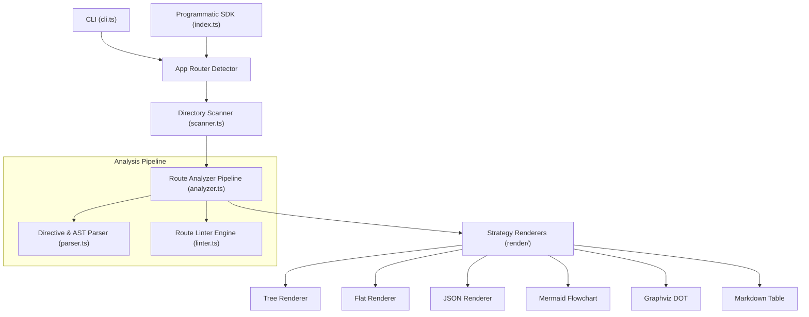
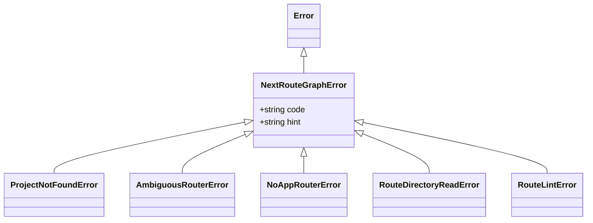

# next-route-graph Architecture

This document describes the architectural design, core pipelines, and component boundaries of `next-route-graph`.

---

## 1. High-Level System Overview

`next-route-graph` operates as both a zero-config Command Line Interface (CLI) and a fully typed programmatic TypeScript SDK. Its goal is to inspect, lint, and visualize the routing topology of Next.js App Router applications without needing a running Next.js server or compiling the application runtime.



---

## 2. Core Architectural Components

### 2.1 Project Detection (`core/detector.ts`)
* Resolves the target project path.
* Discovers whether the project uses `./app` or `./src/app`.
* Throws explicit domain errors (`ProjectNotFoundError`, `AmbiguousRouterError`, `NoAppRouterError`) if the directory structure is invalid or ambiguous.

### 2.2 Filesystem Scanner (`core/scanner.ts`)
* Recursively traverses the App Router directory.
* Excludes build artifacts (`.next`, `dist`, `node_modules`, `coverage`, `.git`).
* Filters for supported source extensions (`.ts`, `.tsx`, `.js`, `.jsx`).
* Returns normalized relative and absolute file paths.

### 2.3 Directive & AST Parser (`core/parser.ts`)
* Identifies Next.js App Router convention files (`page`, `layout`, `loading`, `error`, `not-found`, `template`, `default`, `route`).
* Evaluates `"use client"` and `"use server"` directives.
* Inspects `route.ts` handlers to detect exported HTTP verbs (`GET`, `POST`, `PUT`, `PATCH`, `DELETE`, `HEAD`, `OPTIONS`).
* Extracts route segment configuration exports (`runtime`, `dynamic`).
* Normalizes filesystem paths to canonical URL paths while preserving parallel route slots (`@modal`) and intercepting patterns (`(..)`).

### 2.4 Route Linter Engine (`core/linter.ts`)
* **Dynamic Route Collision**: Flags conflicting parameter declarations at the same routing level (e.g. `/users/[id]` vs `/users/[slug]`).
* **Page vs Route Conflict**: Ensures `page.tsx` and `route.ts` do not exist within the same directory segment.
* **Root Layout Enforcement**: Verifies the presence of a mandatory root `layout.tsx`.
* **Parallel Slot Fallbacks**: Checks that parallel slots (`@slot`) define a `default.tsx` to prevent Next.js 404s during navigation.

### 2.5 Strategy Pattern Renderers (`render/`)
All formatters implement the `OutputRenderer` interface:

```typescript
export interface OutputRenderer {
  render(result: AnalysisResult): string;
}
```

Available formatters:
* **TreeRenderer**: Colorized ANSI terminal tree output with route badges and summary counts.
* **FlatRenderer**: Clean newline-separated URL paths for shell scripting and piping.
* **JsonRenderer**: Formatted JSON for machine consumption, CI automation, and AI context prompts.
* **MermaidRenderer**: Produces Mermaid `flowchart TD` diagrams for embedding in documentation.
* **DotRenderer**: Generates Graphviz DOT syntax for graph visualization.
* **MarkdownRenderer**: Emits GitHub-flavored Markdown tables.

---

## 3. Error Handling Architecture

The project implements a domain-specific error hierarchy inheriting from `NextRouteGraphError`:



Every domain error contains:
* `code`: Machine-readable error code (e.g., `ERR_PROJECT_NOT_FOUND`).
* `hint`: Actionable recommendation explaining how the developer can resolve the issue.
