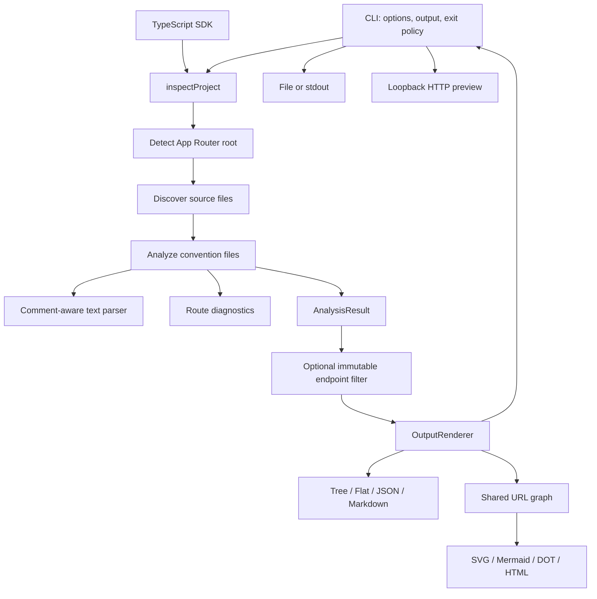

# Architecture

`next-route-graph` scans App Router source files without importing the target project's code. The CLI and SDK share the same analysis pipeline. Renderers consume plain analysis data and return strings; file writes, HTTP serving, and exit policy belong outside that pipeline.

## Boundaries

| Module | Responsibility |
| --- | --- |
| `core/detector.ts` | Select `app/`, `src/app/`, or a direct App Router directory; report missing or ambiguous roots. |
| `core/scanner.ts` | Walk supported source files. Skip private, hidden, dependency, and build directories; do not traverse symlinks. |
| `core/parser.ts` | Recognize convention files, directives, declared methods, and literal config. Resolve URL paths, including interception relative to URL segments. It is a text parser, not an AST. |
| `core/analyzer.ts` | Read each convention file once, construct endpoint entries, index layout files, attach outer-to-inner layout chains, compute counts, and run lint. |
| `core/inspect.ts` | Compose detection → scan → analysis for the CLI and SDK; provide immutable filtering and full scan timing. |
| `core/linter.ts` | Return diagnostics, never choose process exit codes. Partition collision checks by parallel branch and exclude intercepted variants from ordinary URL collision checks. |
| `render/graph.ts` | Build a URL trie including non-endpoint segments; retain every source at shared URLs. Provide shared markup escaping for HTML/XML. |
| `render/*` | Convert `AnalysisResult` into text, SVG, or HTML. No filesystem writes, network calls, or process exits. |
| `preview.ts` | Serve only an in-memory HTML report on `127.0.0.1`, with GET/HEAD, no filesystem access, and explicit listen errors. |
| `cli.ts` | Validate output selection and port; choose format, destination, and CI policy; report errors to stderr. |

## Data contracts

`DiscoveredFile` has an absolute path for reads and a normalized App Router-relative path for output. `RouteEntry` represents an endpoint source, not a unique URL: parallel views and intercepted variants can share a public path. `RouteFile` describes convention files in the endpoint's filesystem directory. `layoutChain` records the layouts found in ancestor directories.

`AnalysisResult` contains project identity, endpoint entries, summary counts, scan duration, and lint results. JSON exports preserve that shape. `filterRoutes()` returns a new result, recalculates endpoint-related counts, and retains project-wide convention totals and diagnostics. Strict validation always uses the full scan.

`RouteGraphNode` represents a URL segment. Its `routes` array retains every endpoint source at that path; an empty array means a grouping segment. Nodes have unique export-local IDs, a parent ID, depth, and normalized path. SVG, Mermaid, and DOT use this same model. These edges represent URL ancestry, not layout or import relationships.

## Complexity and failure handling

Scanning and source extraction scale with discovered files and bytes read. Layout lookup uses a directory index and walks only each endpoint's ancestors, rather than searching every file at every depth. Graph construction creates nodes for URL prefixes and sorts siblings for deterministic traversal. Source reads remain sequential to bound open files and memory; no concurrency framework or cache is needed for a one-shot local scan.

Detection, directory reads, and convention-file reads raise typed errors with codes and hints. Read failures abort analysis: silently substituting an empty source would turn missing metadata into misleading findings. Renderers do not catch these errors or mutate process state. Unknown renderer formats throw rather than silently producing a terminal tree.

CLI reports are written before strict lint exit policy runs, so failing CI jobs can retain artifacts. Preview validates strict policy before starting, so a failed check never leaves a server alive. Operational notices use stderr; successful exports go to stdout or a file.

## Offline report and security

The report contains a pre-rendered SVG, route table, health diagnostics, and encoded JSON for interaction. HTML/XML text and attributes are escaped; `<` is Unicode-escaped in embedded JSON to prevent script termination. Browser interactions create text nodes instead of interpolating source data into HTML. A content security policy blocks network dependencies. Browser script and styles are inline so reports work from disk.

CSV cells are quoted and formula-leading values receive a leading apostrophe. Downloads use local Blob URLs. Clipboard failure opens the selectable source instead. The preview serves a static snapshot with no cache, no directory listing, and no arbitrary file routes.

The report exposes filenames, endpoint names, and detected metadata, not file bodies. Its purpose is architecture inspection, not vulnerability detection or runtime verification.

## Verification

- Node's test runner covers parsing, scanning, linting, renderers, source escaping, immutable filtering, the built SDK, CLI file exports, strict policy, and HTTP preview behavior.
- `npm test` builds production artifacts first, so CLI and consumer tests cannot accidentally validate an old `dist/`.
- Playwright is development-only. Browser tests open local HTML offline and exercise keyboard selection, duplicate endpoint details, search, filters, all downloads, SVG XML validity, hostile source data, formula-safe CSV, and mobile overflow.
- CI tests the CLI on Windows and Linux and runs browser checks on Linux. No Next.js runtime is required.

See [ADR 0001](adr/0001-offline-reports-and-shared-route-graph.md) for the rendering trade-off and [README limitations](../README.md#scope-and-limitations) for the analysis boundary.
